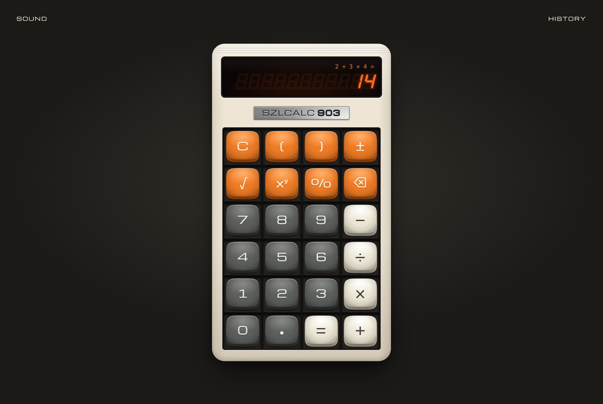

# SZLCALC 903

A retro calculator: React + TypeScript frontend, Go REST API. The browser does
no arithmetic. It builds the expression and the API evaluates it.

**Live:** https://sezzlecalc.vercel.app · **API:** https://sezzlecalc-api.vercel.app



## Run it

Needs Go 1.25+ and Node 26 (pinned in `frontend/.nvmrc`; with nvm, `make` picks it up).

```sh
make install   # frontend dependencies
make dev       # API on :8080 + frontend on :5173 → open http://localhost:5173
```

Separately: `make run` (API only) and `make web` (frontend only, proxies `/api` to :8080).

**Docker:** one 16 MB image, where the Go server also serves the built frontend.

```sh
docker build -t sezzlecalc .
docker run --rm -p 8080:8080 sezzlecalc    # → http://localhost:8080
```

(`make docker` and `make docker-run` do the same.)

## Tests and coverage

```sh
make test    # every Go and frontend test
make cover   # coverage: backend/coverage.html, frontend/coverage/index.html
```

| Layer | Tests | Statement coverage |
|-------|-------|--------------------|
| Go: math and parser (`internal/calc`) | table tests + fuzz target | 98.6% |
| Go: HTTP API (`internal/api`) | handlers, middleware, rate limit, static files | 98.6% |
| Frontend (`src/`) | 194 Vitest + Testing Library tests | 90.7% |

Server startup (`cmd/server`) is deliberately not chased to 100%.

## API

```sh
curl -X POST http://localhost:8080/api/v1/evaluate \
  -H 'Content-Type: application/json' \
  -d '{"expression": "2 + 3 * 4"}'
# → {"expression":"2 + 3 * 4","result":14}
```

| Method | Route | Body | Result |
|--------|-------|------|--------|
| GET | `/health` | none | `{"status":"ok"}` |
| POST | `/api/v1/add` | `{"a":1,"b":2}` | `{"operation":"add","a":1,"b":2,"result":3}` |
| POST | `/api/v1/subtract` | `{"a":5,"b":2}` | same shape |
| POST | `/api/v1/multiply` | `{"a":6,"b":7}` | same shape |
| POST | `/api/v1/divide` | `{"a":10,"b":4}` | same shape |
| POST | `/api/v1/power` | `{"a":2,"b":10}` | same shape |
| POST | `/api/v1/percentage` | `{"a":10,"b":50}` (10% of 50) | same shape |
| POST | `/api/v1/sqrt` | `{"a":9}` | `{"operation":"sqrt","a":9,"result":3}` |
| POST | `/api/v1/evaluate` | `{"expression":"(2+3)^2 - 50%"}` | `{"expression":"…","result":24.5}` |

`evaluate` understands `+ − × ÷ ^`, `√`/`sqrt`, postfix `%` (`50%` = 0.5),
parentheses and unary minus, with normal precedence (`-2^2` = −4).

Errors always look like `{"error":{"code":"division_by_zero","message":"cannot divide by zero"}}`:

| Status | When |
|--------|------|
| 400 | malformed JSON, missing or mistyped field, unknown field |
| 404 / 405 | unknown route / wrong method |
| 413 / 415 | body over 4 KiB / not `application/json` |
| 422 | valid request that can't be computed: division by zero, √ of a negative, overflow, expression syntax |
| 429 | rate limit (10 req/s per client, bursts of 20), with `Retry-After` |

## Design decisions

### Decided by Gabriel

- Include all three optional operations; percentage means "a% of b", and `10%` = 0.1.
- One route per operation, plus `/evaluate` for several operations in one request.
- Rate limiting with `golang.org/x/time/rate`, and it must be tested.
- A retro desktop-calculator look instead of Apple's; extra operations on the orange
  top keys; named SZLCALC 903.
- Tailwind, shadcn (page controls only) and motion design; sound effects with a mute
  control; history kept in the browser, grouped by day.
- One Docker image for the whole app; publish on Vercel.
- Work in three reviewed plans, with every prompt and its time logged in `prompts.md`.
- Coverage is not chased to 100% (server startup stays untested).
- `=` never shows input errors: an unfinished end (`2 + 3 ×`) is dropped; `=` on a shown
  result blinks it.
- 11-digit display (10 plus a minus sign), as on the reference device.
- Pre-calculate after a pause in typing so `=` feels instant; skip input with nothing to
  calculate; cache answers.
- Text-only controls; the brushed-metal and shell textures; the keycap specification;
  concentric corners; copy and paste with strict validation.
- Drop the typing animation and scroll arrows after trying them.

### Proposed and built by Claude

- Go standard library HTTP, no framework; math (`calc`) and HTTP (`api`) in separate
  packages so each is tested alone.
- A hand-written parser that reads the whole expression before computing, so syntax
  errors win over math errors; length and nesting limits; a fuzz test.
- Results rounded to 15 significant digits (`0.1 + 0.2` = 0.3).
- One error format; 400 for bad input vs 422 for input that can't be computed; strict
  JSON (unknown fields, trailing data and wrong types rejected).
- Rate limit keyed on the connection address, ignoring `X-Forwarded-For`, which clients
  can fake; an opt-in trusted header (`CLIENT_IP_HEADER`) for proxies that overwrite it,
  as Vercel does.
- No arithmetic in the browser; the expression shown is exactly the one sent; implicit
  `×` (`2(3)` → `2 × (3)`) and parenthesized negatives (`(−5)`), since the API rejects
  ambiguous input.
- The UI only calls `/evaluate`; the per-operation routes serve other API users.
- Sounds synthesized with Web Audio (no audio files); display digits sized with
  container queries; only definitive errors cached, never network or rate-limit errors.
- Same-origin everywhere: Vite proxy in development, Vercel rewrites in production, and
  the Go server serving the frontend in Docker (`STATIC_DIR`) with a strict
  Content-Security-Policy, so no CORS anywhere.
- Distroless, non-root runtime image.

## Known limits

- On Vercel the rate limit is per server instance, so it is weak there; a strict global
  limit needs a shared store. In Docker, clients behind the same address share a limit.
- Numbers are float64: about 15 significant digits.
- History lives in each browser's local storage.

## Time spent

**3h 47m**, breaks excluded, against a 2h target and a 4h ceiling. Every prompt is
logged with timestamps in [`prompts.md`](prompts.md).
